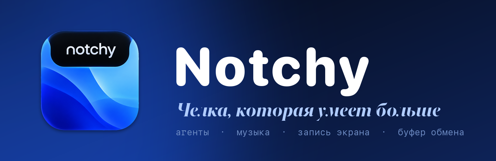

<p align="center">
  
</p>

<p align="center">
  
  
  
</p>

<p align="center">
  <a href="README.md">Русский</a> &nbsp;·&nbsp; <b>English</b>
</p>

<br>

> Notchy turns the cutout on your MacBook into a small panel. Hover over it, the notch opens up, and inside is the stuff you'd otherwise hunt for in other windows.

It's a small app and I build it alone. No Dock icon: everything lives in the notch and a menu bar item.

<br>

## <kbd>What's inside</kbd>

Five tabs. You can hide the ones you don't need.

**Agents.** Shows what Claude Code, Codex, Antigravity and Cursor are up to: working or waiting for your approval, and in which project. When a task is done you get a notification and a quiet sound. If the main agent finished its turn but its subagents are still running, "done" won't show up early.

**Music.** What's playing right now: Apple Music, Spotify, YouTube in a browser, VLC, IINA, QuickTime. Artwork, pause, skip and an equalizer that moves with the sound. If a player can't report its track to the system, the title is read from its window.

**Screen recording.** Regular recording with a choice of resolution (native, 1080p, 720p), frame rate (30, 60 or 120) and bitrate (8 to 50 Mbps). Microphone and system audio are optional. There's also an instant replay: the app keeps the last 1, 2, 5, 10 or 15 minutes of your screen in the background, and a hotkey saves them to a file. Handy when something just happened and you weren't recording.

**Clipboard.** History of 50 items: text, images, files. Click an item to paste it.

**Settings.** Quick toggles right in the notch: replay, microphone, system audio, keep awake, notifications. Everything else is in a separate window.

### Drop a file on the notch

Drop it in the middle and it goes to the clipboard. Drop it on one of the formats around it and it gets converted and saved to Downloads. Works with images, video, audio, documents and PDF. Most formats use what macOS already has. WebM, MKV, AVI, GIF, MP3, Ogg and Opus need `ffmpeg` (`brew install ffmpeg`).

### Small things

- **Keep awake** for 30 minutes, an hour, two, five, or forever. There's a closed-lid mode too, it asks for an administrator password.
- **Mouse side buttons** switch tabs: Back goes to the next one, Forward to the previous.
- **External displays.** You can hide the notch there, and it slides out when you move the cursor to the top edge, in the middle. On a display without a cutout it draws its own shape.
- **Nine languages:** Russian, English, French, German, Italian, Spanish, Japanese, Chinese, Korean.
- **The menu bar icon** can be turned off, settings stay reachable from the notch.

<br>

## <kbd>Install</kbd>

1. Download `Notchy.dmg` from [Releases](../../releases).
2. Drag Notchy to Applications. Keep it there, otherwise macOS may reset permissions after updates.
3. Launch it. The app is signed without an Apple Developer certificate, so macOS may refuse to open it. Run `Если macOS блокирует запуск.command` from the disk image, or in Terminal:

   ```sh
   xattr -dr com.apple.quarantine /Applications/Notchy.app
   ```

4. Grant permissions. The welcome window explains what each one is for: screen recording, accessibility, microphone, notifications.

Requires macOS 13 or later. The image is universal, so it runs on Apple Silicon and Intel.

### Connecting agents

Settings, "Agents" section. Switch one on and Notchy adds a small hook to its config. Switch it off and the hook is removed. Other hooks are left alone, and a backup of the config is saved next to it before the first change.

The hook itself (`notchy-hook.pl` in `~/Library/Application Support/Notchy`) doesn't send anything anywhere. It only writes short events to a local file that the notch reads.

<br>

## <kbd>Resource usage</kbd>

These numbers come from one laptop: MacBook Pro with M1 Pro, 16 GB, an external 1080p 144 Hz display. 25-second samples with `top`, where 100% is one core.

| Mode | CPU |
|:--|--:|
| No instant replay | about 11% |
| Replay at 30 FPS | about 21% |
| Replay at 60 FPS | about 25% |

Memory is around 100 MB.

A few notes:

- I measured it while music was playing and an agent was working, so this isn't a clean idle. 11% is probably an upper estimate. Most of it goes to polling the player and redrawing the UI.
- Instant replay is the heaviest part because it encodes video all the time. Encoding is hardware accelerated, but you can still see it in the numbers. If load matters, turn replay off or drop it to 30 FPS. Replay is always capped at 1080p and 16 Mbps, however you set up regular recording.
- Replay is stored in 30-second chunks in `~/Library/Caches/Notchy`. At the 16 Mbps cap a minute takes up to 120 MB. In practice 1080p at 60 FPS gives me about 7 Mbps, around 55 MB a minute. The buffer is cleared on launch and when replay is switched off.
- The only network use is for artwork: it searches iTunes and loads YouTube thumbnails. The track title is part of that request. There are no other network calls.

<br>

## <kbd>Build from source</kbd>

You need Xcode. No third-party dependencies.

```sh
git clone https://github.com/OnlyYuta/notchy.git
cd notchy
./scripts/build_and_run.sh   # regular build and run
./scripts/make_dmg.sh        # universal Release and Notchy.dmg
```

<br>

## <kbd>Rough edges</kbd>

- No signing or notarization, hence the quarantine dance on first launch.
- If an agent starts a command in the background and ends its turn, "done" will show up while the command is still running. The system doesn't give me a way to tell that apart from a real finish yet.
- I've only tested it on my own Mac. On other models and system versions things may behave differently, issues are welcome.

<br>

<p align="center">
  <sub>Made by <a href="https://github.com/OnlyYuta">OnlyYuta</a></sub>
</p>
