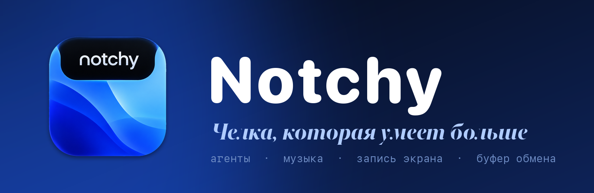

<p align="center">
  
</p>

<p align="center">
  
  
  
</p>

<p align="center">
  <b>Русский</b> &nbsp;·&nbsp; <a href="README.en.md">English</a>
</p>

<br>

> Notchy превращает вырез на MacBook в маленькую панель. Наводишь курсор, челка раскрывается, а внутри то, за чем обычно приходится лезть в другие окна.

Приложение небольшое, делаю его один. Живёт без значка в Dock, всё управление через челку и иконку в строке меню.

<br>

## <kbd>Что внутри</kbd>

Пять вкладок. Лишние можно скрыть в настройках.

**Агенты.** Показывает, чем заняты Claude Code, Codex, Antigravity и Cursor: работают они или ждут твоего подтверждения, и в каком проекте. Когда задача закончена, приходит уведомление и тихий звук. Если главный агент закончил ход, а его субагенты ещё работают, слово «готово» не появится раньше времени.

**Музыка.** Что сейчас играет: Apple Music, Spotify, YouTube в браузере, VLC, IINA, QuickTime. Обложка, пауза, перемотка и эквалайзер, который двигается в такт звуку. Если плеер не умеет сообщать трек системе, название берётся из его окна.

**Запись экрана.** Обычная запись с выбором разрешения (родное, 1080p, 720p), частоты кадров (30, 60 или 120) и битрейта (от 8 до 50 Мбит/с). Можно писать микрофон и звук системы. Отдельно есть мгновенный повтор: приложение в фоне держит последние 1, 2, 5, 10 или 15 минут экрана, а по горячей клавише сохраняет их в файл. Пригодится, когда что-то случилось секунду назад, а запись ты не включал.

**Буфер обмена.** История на 50 записей: текст, картинки, файлы. Клик по записи вставляет её.

**Настройки.** Быстрые переключатели прямо в челке: повтор, микрофон, звук системы, «не давать Mac засыпать», уведомления. Всё остальное в отдельном окне.

### Перетащи файл на челку

Бросил в середину, и файл попал в буфер обмена. Бросил на один из форматов вокруг, и он сконвертируется и ляжет в «Загрузки». Работает с картинками, видео, аудио, документами и PDF. Большая часть форматов обходится встроенными средствами macOS. Для WebM, MKV, AVI, GIF, MP3, Ogg и Opus нужен `ffmpeg`, его можно поставить так: `brew install ffmpeg`.

### Мелочи

- **Не давать Mac засыпать** на 30 минут, час, два, пять часов или насовсем. Есть вариант с закрытой крышкой, ему нужен пароль администратора.
- **Боковые кнопки мыши** листают вкладки: «Назад» открывает следующую, «Вперёд» предыдущую.
- **Внешние мониторы.** Челку можно скрыть, тогда она выезжает, когда подводишь курсор к верхнему краю по центру. На мониторе без выреза она рисуется своей формой.
- **Девять языков:** русский, английский, французский, немецкий, итальянский, испанский, японский, китайский, корейский.
- **Иконку в строке меню** можно убрать, настройки останутся доступны из челки.

<br>

## <kbd>Установка</kbd>

1. Скачай `Notchy.dmg` на странице [Releases](../../releases).
2. Перетащи Notchy в «Программы». Лучше держать его именно там, иначе macOS может сбрасывать разрешения после обновлений.
3. Запусти. Приложение подписано без сертификата разработчика Apple, поэтому macOS может отказаться его открывать. Тогда запусти `Если macOS блокирует запуск.command` из образа или выполни в терминале:

   ```sh
   xattr -dr com.apple.quarantine /Applications/Notchy.app
   ```

4. Выдай разрешения. Окно приветствия объяснит, что и зачем нужно: запись экрана, универсальный доступ, микрофон, уведомления.

Нужна macOS 13 или новее. Образ универсальный, подходит и Apple Silicon, и Intel.

### Подключение агентов

Настройки, раздел «Агенты». Включаешь нужного, и Notchy дописывает в его конфиг один небольшой хук. Выключаешь, и хук убирается. Чужие хуки не трогаются, а перед первым изменением конфига рядом лежит его резервная копия.

Сам хук (`notchy-hook.pl` в `~/Library/Application Support/Notchy`) ничего никуда не отправляет. Он только записывает короткие события в локальный файл, который читает челка.

<br>

## <kbd>Нагрузка</kbd>

Цифры мои, с одного ноутбука: MacBook Pro на M1 Pro, 16 ГБ, внешний монитор 1080p на 144 Гц. Замеры по 25 секунд через `top`, 100% это одно ядро.

| Режим | CPU |
|:--|--:|
| Без мгновенного повтора | около 11% |
| Повтор в 30 FPS | около 21% |
| Повтор в 60 FPS | около 25% |

Памяти приложение занимает около 100 МБ.

Что к этому добавить:

- Мерил в рабочей обстановке: играла музыка и работал агент. Чистого простоя без всего этого я не снимал, так что 11% скорее верхняя оценка. Основная часть уходит на опрос плеера и перерисовку интерфейса.
- Самое тяжёлое здесь мгновенный повтор: видео кодируется всё время. Кодирование аппаратное, но разница в цифрах видна. Если нагрузка важна, выключи повтор или поставь 30 FPS. Повтор всегда пишется не выше 1080p и 16 Мбит/с, как бы ты ни настроил обычную запись.
- Повтор хранится кусками по 30 секунд в `~/Library/Caches/Notchy`. При потолке 16 Мбит/с минута весит до 120 МБ. На деле у меня 1080p в 60 FPS даёт около 7 Мбит/с, то есть порядка 55 МБ в минуту. Буфер чистится при запуске и при выключении повтора.
- В интернет приложение ходит только за обложками: ищет их в iTunes и берёт превью с YouTube. Название трека попадает в такой запрос. Больше никаких обращений в сеть нет.

<br>

## <kbd>Сборка из исходников</kbd>

Нужен Xcode. Сторонних зависимостей нет.

```sh
git clone https://github.com/OnlyYuta/notchy.git
cd notchy
./scripts/build_and_run.sh   # обычная сборка и запуск
./scripts/make_dmg.sh        # универсальный Release и Notchy.dmg
```

<br>

## <kbd>Что пока не идеально</kbd>

- Нет подписи и нотаризации, отсюда танцы с карантином при первом запуске.
- Если агент запустил команду в фоне и закончил ход, «готово» придёт, хотя команда ещё идёт. Отличить такой случай от настоящего конца системой пока не получается.
- Тестировал на своём Mac. На других моделях и версиях системы что-то может вести себя иначе, буду рад issue.

<br>

<p align="center">
  <sub>Сделал <a href="https://github.com/OnlyYuta">OnlyYuta</a></sub>
</p>
